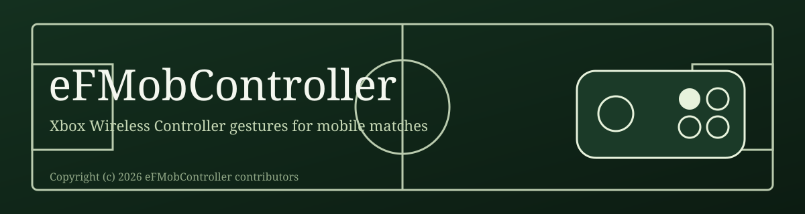
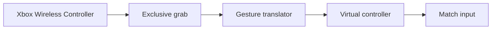

  

  
  
  

eFMobController turns Xbox Wireless Controller gestures into the controller chords a mobile match already understands. The left stick stays movement and aim. The right stick, the bumpers, and the triggers become the feints, the kicks, and the defensive calls.

The Android application id is `com.padlayer`. This repository is the whole project.

## How a gesture becomes a command

A normal app cannot take the physical pad or create a virtual one. Those device nodes belong to the shell user. The phone app, or the script in `scripts/`, starts that shell process through wireless debugging. After it is running, the computer can be unplugged. It keeps running until Stop or a reboot.

Supported today: the **Xbox Wireless Controller** over Bluetooth. Other pads are not mapped. A contribution that adds one, with the same gesture tests, is welcome.

## Clean room

This repository was written with clean-room methods. It contains only original code. It does not include the game, its assets, decompiled code, or data from any particular phone. Behavior was determined by observing the controller events a match already accepts. There is no private command to call, and this project does not hook the game.

## Commands

The match reads buttons and sticks. The translator sends the chord for each gesture.

- A spin of the right stick is a Marseille. The same spin while sprinting is a rainbow.
- Up then down is a double touch. RB opens it, LB closes it.
- A side flick is a body feint. The opposite side soon after is a flip flap. LB plus a side flick is an L feint.
- LB and RB together plus a flick is a chop. RB and a flick back is a Scotch move. A flick back steps on the ball.
- A half spin forward is scissors. Clicking the right stick while it points forward is a step-over.
- Clicking the left stick while the right stick is held is a sombrero.
- Double-tap sprint while moving, or flick the right stick forward while sprinting, for the sharp touch.
- Hold the left trigger and move for finesse dribbling.
- One press of A, B, X, or Y is the normal kick, and the sprint trigger stays down so a press or a tackle can still sprint. A second press is the stunning kick, and that second hold is the power.
- Hold LB and double-tap Y for a stunning chipped through ball.
- Hold LB and press X for a chip. Hold RB and press X for a controlled shot. Neither of those adds the sprint trigger.
- After a kick, both bumpers with the right stick centered cancel it.
- LB switches players. RB calls a teammate to press. Hold Y and the keeper comes out.
- D-pad right raises the attack level by one. D-pad left lowers it. D-pad up holds the teammate press. D-pad down holds the player switch.
- Start opens the pause menu. Menus outside the match do not read the controller.

## Copyright

Copyright (c) 2026 eFMobController contributors.

## License

GNU General Public License v3.0 only. See [LICENSE](LICENSE).

You can use this, change it, and build on it. If you distribute a version, you keep this license and you ship the corresponding source with it. A closed copy is not allowed. Contributions stay under the same terms, including new controller maps.

## Building

The modules are `engine`, `bridge`, and `app`. Java 21 and an Android SDK are required. `local.properties` is not part of this repository. Point `sdk.dir` at the SDK on the machine that builds it.

`scripts/start-bridge.ps1` loads the translator from a computer. The app can start the same process from the phone once wireless debugging is paired.
